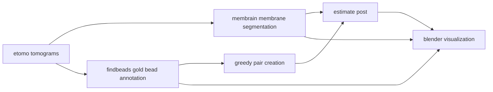

# findingampa

[![Actions Status][actions-badge]][actions-link]
[![Documentation Status][rtd-badge]][rtd-link]

[![PyPI version][pypi-version]][pypi-link]
[![Conda-Forge][conda-badge]][conda-link]
[![PyPI platforms][pypi-platforms]][pypi-link]

[![GitHub Discussion][github-discussions-badge]][github-discussions-link]

<!-- SPHINX-START -->

<!-- prettier-ignore-start -->
[actions-badge]:            https://github.com/jojoelfe/findingampa/workflows/CI/badge.svg
[actions-link]:             https://github.com/jojoelfe/findingampa/actions
[conda-badge]:              https://img.shields.io/conda/vn/conda-forge/findingampa
[conda-link]:               https://github.com/conda-forge/findingampa-feedstock
[github-discussions-badge]: https://img.shields.io/static/v1?label=Discussions&message=Ask&color=blue&logo=github
[github-discussions-link]:  https://github.com/jojoelfe/findingampa/discussions
[pypi-link]:                https://pypi.org/project/findingampa/
[pypi-platforms]:           https://img.shields.io/pypi/pyversions/findingampa
[pypi-version]:             https://img.shields.io/pypi/v/findingampa
[rtd-badge]:                https://readthedocs.org/projects/findingampa/badge/?version=latest
[rtd-link]:                 https://findingampa.readthedocs.io/en/latest/?badge=latest

<!-- prettier-ignore-end -->

This repository contains code for various pipelines to identify and ultimately average AMPA receptors found in cryo-electron tomograms. 

## Pipelines

### Pipeline 1


## Usage

```
finding_ampa run-pipeline1
```

## Data organization

The project will maintain a star file that organizes the data and the output of the various pipelines. The star file will have the following sections:

- FASettings: Cotaining setting for the project such as the path to the processing directory
- FAData: For each tomograms containing the path to various datafiles, such as already reconstructed tomograms, movies, and potentially also annotation of experimental conditions
- FAPipelines: List all the pipelines, with a name and a short descriptions
- FAPipelineXSettings: Contains settings specific for Pipeline X
- FAPipelineXData: List specific data for Pipeline X. Each row represents a tomogram


